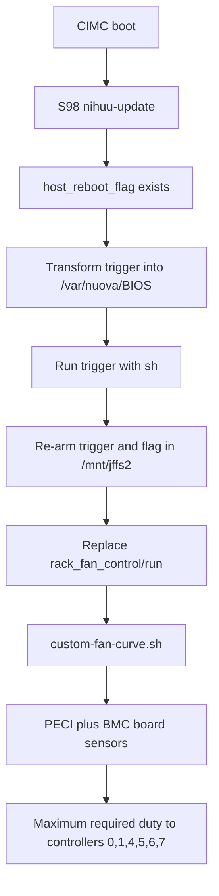

# Cisco C240 M5 Fan Controller

Last updated: 2026-09-20

## Purpose

This runbook records the custom temperature-responsive fan controller installed on the C240 M5 that hosts two passive NVIDIA V100 PCIe GPUs.

The server's configured `Acoustic` policy was overridden by CIMC to `High Power` because of its PCIe inventory. All six installed fan modules consequently ran at approximately 13,400–14,700 RPM while the machine was cool. The custom controller retains a conservative airflow floor, monitors both CPU sockets and both GPU risers, and raises cooling immediately when a sensor or PWM command fails.

This is an unsupported CIMC modification. Disable it and restore Cisco's controller before applying CIMC, BIOS, HUU, or other Cisco firmware updates.

## Sources

- [Amateur-God C240 M5 fan-controller project](https://github.com/Amateur-God/cisco-c240m5-fan-controller)
- [Project author's C240 M5 write-up](https://www.reddit.com/r/homelab/comments/1wflmwb/i_replaced_my_cisco_c240_m5s_inletbased_fan_curve/)
- [Earlier HUU fan-control research](https://www.reddit.com/r/homelab/comments/1pden94/hacking_cimc_to_lower_fan_speeds_success/)
- [Cisco IMC argument-injection advisory](https://sec.cloudapps.cisco.com/security/center/content/CiscoSecurityAdvisory/cisco-sa-cimc-arg-inject-upSHdMfU)

## Current Deployment

| Item | Value |
| --- | --- |
| Server | Cisco UCS C240 M5 |
| CIMC | `192.168.1.105` |
| CIMC firmware | `4.3(2.250045)` |
| Ubuntu host | `cisco-v100`, reserved at `192.168.1.108` |
| GPUs | Two passive NVIDIA V100 PCIe 32 GB, slots 2 and 5 |
| Fan modules | Six dual-fan modules |
| Configured Cisco policy | Acoustic |
| Applied Cisco policy before override | High Power; HCL/Mellanox-card reason |
| Custom minimum duty | 10% (~3,200–3,500 RPM) |
| Busy-GPU minimum | 20% (~5,000–5,300 RPM) |
| GPU demand endpoint | `http://192.168.1.108/duty` |
| Native run target saved on CIMC | `/opt/flash/var/service/rack_fan_control/run` |

No command loop, reverse shell, network listener, or general-purpose command channel is installed on CIMC.

## Boot and Runtime Design

The controller files live on persistent JFFS2 storage. Cisco's late HUU init script consumes a one-shot flag and trigger, explicitly invokes the transformed trigger with `sh`, and removes the active copies. The trampoline recreates both files for the next CIMC boot, replaces the supervised fan-service entry, and stops the native daemon so its supervisor starts the custom controller.



The active scripts are in [scripts/cisco-c240-m5/fan-controller](../cimc/).

| Repository file | CIMC location | Purpose |
| --- | --- | --- |
| `custom-fan-curve.sh` | `/mnt/jffs2/custom-fan-curve.sh` | Reads temperatures and sets PWM |
| `nihuu-trampoline.sh` | `/mnt/jffs2/fanboot.trigger` and active HUU trigger | Restores the custom service after each CIMC boot |
| `rollback-fan-controller.sh` | `/mnt/jffs2/rollback-fan-controller.sh` | Disables the hook and restores Cisco control |
| `rollback-trigger.sh` | `/mnt/jffs2/rollback-trigger.sh` | One-shot HUU entry point for rollback |
| `install-fan-controller.sh` | `/mnt/jffs2/install-fan-controller.sh` | Fixed-purpose initial installer |

`fixed-purpose-installer.c` is the source for the one-time ARM library used during initial installation. Its constructor can only invoke the fixed installer path; it contains no callback or user-controlled command.

## Fan Curve

The controller selects the maximum duty requested by any sensor. It raises duty immediately and lowers it in five-point steps to prevent abrupt acoustic changes.

### CPU package curve

Both populated CPU sockets are read through PECI.

| Hottest CPU | Duty |
| --- | --- |
| Below 60°C | 10% |
| 60–64°C | 40% |
| 65–69°C | 50% |
| 70–74°C | 60% |
| 75–79°C | 75% |
| 80–84°C | 90% |
| 85°C or above | 100% |

### Board-sensor ramps

Each range is linear from zero contribution at `Start` to 100% duty at `Full`. The global 10% floor still applies.

| Sensor | Start | Full |
| --- | ---: | ---: |
| `MLOM_TEMP` | 65°C | 90°C |
| `PCH_TEMP_SENS` | 55°C | 80°C |
| `BMC_DIE_TEMP` | 70°C | 85°C |
| `RISER1_TEMP` | 45°C | 65°C |
| `RISER2_TEMP` | 45°C | 65°C |
| `RISER1_INLET_TMP` | 40°C | 60°C |
| `RISER2_INLET_TMP` | 40°C | 60°C |
| `TEMP_SENS_FRONT` | 35°C | 45°C |
| Hottest DDR4 DIMM | 55°C | 80°C |

Both CPUs, both riser temperatures, both riser-inlet temperatures, and the front temperature are mandatory. A missing, malformed, or out-of-range mandatory reading immediately requests 100% duty. Failure to read the BMC sensor snapshot or set any PWM controller also requests 100% duty.

The passive V100 core temperatures are not visible to CIMC. Ubuntu therefore
runs `cisco-v100-gpu-fan-demand.service`, which reads both cards with
`nvidia-smi` and serves a single numeric duty request on TCP port 80. CIMC
polls that endpoint and takes the maximum of GPU demand and its native
CPU/board curve. A missing, malformed, or unreachable GPU response requests
30% rather than leaving passive cards at the quiet floor.

| GPU state | Requested duty |
| --- | ---: |
| Idle, below 71°C | 10% |
| Either GPU at ≥10% utilisation or ≥60 W | 20% |
| Hottest GPU ≥71°C | 30% |
| Hottest GPU ≥75°C | 40% |
| Hottest GPU ≥78°C | 60% |
| Hottest GPU ≥80°C | 100% |

Thermal steps have 2°C release hysteresis so the fans do not hunt at a
boundary. Increases are immediate. The local CPU, board-sensor, PWM, and
mandatory-sensor fail-safes remain authoritative and can always request more.

## Commissioning Result

The first CIMC-only reboot took approximately four minutes. Ubuntu remained online throughout, the HUU trigger ran, and both trigger files were re-armed successfully.

| Measurement | Cisco control before | Custom control at idle |
| --- | ---: | ---: |
| Fan RPM range | 13,433–14,700 | 7,272–7,575 |
| Front inlet | 28–29°C | 29°C |
| CPU board sensors | 34°C | 35–35.5°C |
| CPU PECI | Not recorded in CLI baseline | 35–36°C |
| MLOM | 34°C | 39°C |
| PCH | 30°C | 32°C |
| Riser 1 / 2 | 26°C / 27°C | 26°C / 28°C |
| Riser inlet 1 / 2 | 29°C / 30°C | 31°C / 33°C |
| Hottest DIMM | 28°C | 29°C |

The runtime log showed a controlled descent from duty 100 to 35 and then stable `reason=curve` entries. It contained no sensor or PWM fail-safe events.

## Initial LLM Load Validation

On 20 September 2026, all three Qwen 3.8 27B quantizations were benchmarked
with a verified 1:1 split across both V100s. The test used a 2,048-token prompt,
256-token generation, three repetitions, flash attention, Q8 KV cache, and the
187.5 W per-GPU power limit.

| Measurement | Result |
| --- | ---: |
| GPU 0 peak | 69°C, 184.0 W |
| GPU 1 peak | 60°C, 190.8 W |
| CPU 1 / CPU 2 peak | 48°C / 51°C |
| Fan rotor range | 7,272–7,840 RPM |
| Q4_K_M generation | 33.31 tokens/s |
| Q6_K_M generation | 25.92 tokens/s |
| Q6_K_L generation | 25.16 tokens/s |

This was the original 35% commissioning test. It motivated adding a direct
NVIDIA-temperature control path instead of relying on CIMC inlet or riser
temperatures.

### GPU-aware validation

On 20 September 2026, the final controller completed a ten-minute Q4_K_M soak
with direct host GPU demand, a 10% idle floor, and the 187.5 W power cap.

| Measurement | Result |
| --- | ---: |
| GPU 0 peak | 75°C |
| GPU 1 peak | 71°C |
| Idle fan rotor range | 3,232–3,528 RPM |
| Busy 20% fan range | 5,050–5,292 RPM |
| Observed thermal-response maximum | 9,016 RPM |
| Q4_K_M generation | 32.60 tokens/s |

The host demand changed to 20% as soon as GPU power/utilisation indicated work,
then to 30% at 71°C and 40% at 75°C. Neither GPU reached the 80°C warning.

## Verification

From the CIMC CLI:

```text
scope sensor
show fan
show temperature
```

Expected idle state on this installation:

- `MOD1` through `MOD6` fan sensors are `Normal`;
- `MOD7_FAN1_SPEED` is unavailable because no seventh module is installed;
- fan speed is approximately 3,200–3,500 RPM at the 10% idle floor;
- active GPU work requests at least 20%, approximately 5,000–5,300 RPM;
- both riser and inlet sensors are present;
- all reported temperatures remain `Normal`.

With authorized CIMC root file access, inspect the RAM-only log:

```sh
tail -50 /tmp/custom-fan-curve.log
```

Normal lines contain `reason=curve`. Investigate immediately if they contain `sensor-failsafe` or `pwm-failsafe`.

## Rollback

The rollback script first drives all six PWM controllers to 100%, removes the persistent HUU trigger and flag, stops the custom controller, and restores the saved native service link.

With a CIMC root shell:

```sh
sh /mnt/jffs2/rollback-fan-controller.sh
```

When only the authorized file-write path is available:

1. Write `rollback-trigger.sh` to `/mnt/jffs2/nihuu_delay_cimc_reboot`.
2. Create `/mnt/jffs2/host_reboot_flag`.
3. Reboot only the CIMC.
4. Confirm the fans return to Cisco's policy and the Ubuntu host stayed online.

To re-enable the custom controller later, remove `/mnt/jffs2/fanboot.disabled`, copy `fanboot.trigger` to the active HUU-trigger path, recreate `host_reboot_flag`, and reboot CIMC.

## Firmware and Security Notes

- Do not store the CIMC password or session material in this repository.
- The initial deployment used an authenticated argument-injection vulnerability on an owner-authorized server. The temporary exploit helper was deliberately not committed.
- Cisco has published fixed firmware for CVE-2026-20288. Patching is the correct security posture, but it may remove the file-write method used to maintain this unsupported controller.
- Before any update, perform rollback and verify Cisco's native fan service is active.
- The controller log remains in `/tmp` to avoid JFFS2 flash wear. Only small boot scripts and one-shot markers are stored persistently.
